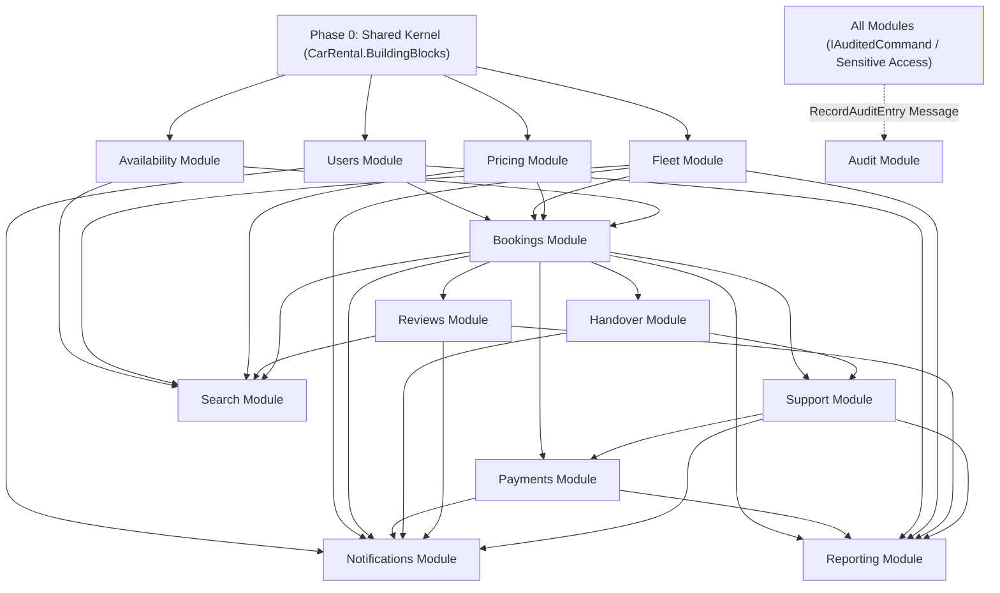

# Car Rental Platform: Master Backend Implementation Plan

> **Author:** Architecture & Backend Engineering Team  
> **Source Design:** [be/docs/domain-model-entities-updated.md](file:///c:/Users/Nguyen/OneDrive/M%C3%A1y%20t%C3%ADnh/DotNet_class/Do_An/vehicle-rental-webapp/be/docs/domain-model-entities-updated.md)  
> **Target Framework:** .NET 9, ASP.NET Core, PostgreSQL 17 + PostGIS, Wolverine 3.8 Outbox, NetArchTest  
> **Scope:** Full implementation plan covering Shared Kernel and 13 modules across isolated git branches and folders.

---

## 1. Executive Summary & Architectural Invariants

The backend follows a **Modular Monolith** architecture. It is deployed as a single unit behind a thin API Host (`CarRental.Api`), while strictly preserving independent domain boundaries across 13 modules and a Shared Kernel:

1. **Rich Domain Model:** Aggregates encapsulate all business invariants and state transitions. No anemic entities (`public set;` is strictly forbidden). State changes go through explicit domain methods (`Approve()`, `Cancel()`, `PlaceHold()`, etc.) with private parameterless constructors for EF Core.
2. **Schema-per-Module Isolation:** Each module owns its dedicated PostgreSQL schema (`users`, `fleet`, `pricing`, `availability`, `booking`, `payments`, `handover`, `search`, `reviews`, `support`, `notifications`, `audit`, `reporting`).
3. **No Cross-Schema Foreign Keys:** Modules reference other aggregates by ID only (`Guid` / strongly-typed IDs like `BookingId`, `UserId`). Cross-schema joins are prohibited.
4. **Contracts-Only Module Communication:** Modules may only reference each other's `*.Contracts` project (exposing synchronous `IApi` interfaces, DTOs, and integration events).
5. **Strict Event Publishing Policy (Small Contract Surface):** An integration event is published in `*.Contracts` **only** if at least one other module needs to react to it. Across the entire platform, there are **exactly 28 published integration events**. Events without external consumers remain **internal domain events** (e.g., `HoldPlaced`, `PromotionRedeemed`, `DamageReported`, `PaymentExpired`, `TicketOpened`).
6. **Asynchronous Consistency via Wolverine Outbox:** State changes publish integration events through the transactional outbox in the same database transaction as `SaveChanges`. Consuming handlers must be idempotent.
7. **Hold Lifecycle & Double-Booking Prevention:** Guaranteed via `IAvailabilityApi` hold logic backed by a PostgreSQL `btree_gist` exclusion constraint (`tstzrange`). Booking owns deadlines and orchestrates hold lifecycle: initial 12h hold on request, extended to `PaymentDeadline` upon owner approval via `IAvailabilityApi.ExtendHoldAsync`, confirmed upon payment, and released on cancel/expire/reject.
8. **Decoupled Security Audit Architecture:** The Audit module does **not** subscribe to business integration events. Instead, `Audit.Contracts` exposes a single message `RecordAuditEntry`, dispatched via the transactional outbox by an Application-layer pipeline behavior (`AuditPipelineBehavior`) for commands marked with `IAuditedCommand` (admin actions, status/role changes, approvals) and sensitive document access (CCCD, GPLX, receipts). Sensitive data (e.g., full citizen ID numbers) is sanitized before emitting.

---

## 2. Git Branching & Collaboration Strategy

To allow a 4-person team or autonomous sub-agents to develop modules concurrently without merge conflicts, each module is allocated an isolated git branch and a dedicated implementation plan:

### 2.1 Branching Convention
```
main (Production / Stable)
  └── dev (Integration & Architecture Test Verification)
        ├── feat/shared-kernel (Phase 0 - BuildingBlocks)
        ├── feat/module-users (Phase 1)
        ├── feat/module-fleet (Phase 1)
        ├── feat/module-pricing (Phase 1)
        ├── feat/module-availability (Phase 1)
        ├── feat/module-bookings (Phase 2)
        ├── feat/module-payments (Phase 2)
        ├── feat/module-handover (Phase 3)
        ├── feat/module-reviews (Phase 3)
        ├── feat/module-support (Phase 3)
        ├── feat/module-search (Phase 4)
        ├── feat/module-notifications (Phase 4)
        ├── feat/module-audit (Phase 4)
        └── feat/module-reporting (Phase 4)
```

### 2.2 Developer / Agent Workflow
1. **Branch Checkout:** Developer/agent checks out their module's branch:
   ```bash
   git checkout dev
   git checkout -b feat/module-<name>
   ```
2. **Contract First:** Build the `CarRental.Modules.<Name>.Contracts` project first.
3. **Domain & Data Implementation:** Implement aggregates, EF Core `DbContext` (`HasDefaultSchema`), and migrations.
4. **Local Verification:** Run module unit tests and Testcontainers integration tests.
5. **Architecture Validation:** Run `dotnet test tests/CarRental.ArchitectureTests` to verify no cross-module encapsulation leaks.
6. **PR to `dev`:** Merge via squash or rebase once all tests pass.

---

## 3. Implementation Phasing & Dependency Matrix



| Phase | Module / Component | Dedicated Git Branch | Local Implementation Plan | Upstream Dependencies & Contracts |
|---|---|---|---|---|
| **0** | **Shared Kernel** | `feat/shared-kernel` | [BuildingBlocks Plan](file:///c:/Users/Nguyen/OneDrive/M%C3%A1y%20t%C3%ADnh/DotNet_class/Do_An/vehicle-rental-webapp/be/src/Shared/CarRental.BuildingBlocks/IMPLEMENTATION_PLAN.md) | None |
| **1** | **Users** | `feat/module-users` | [Users Plan](file:///c:/Users/Nguyen/OneDrive/M%C3%A1y%20t%C3%ADnh/DotNet_class/Do_An/vehicle-rental-webapp/be/src/Modules/Users/IMPLEMENTATION_PLAN.md) | Shared Kernel |
| **1** | **Fleet** | `feat/module-fleet` | [Fleet Plan](file:///c:/Users/Nguyen/OneDrive/M%C3%A1y%20t%C3%ADnh/DotNet_class/Do_An/vehicle-rental-webapp/be/src/Modules/Fleet/IMPLEMENTATION_PLAN.md) | Shared Kernel, `Users.Contracts` (`IUsersApi.IsVerifiedOwnerAsync`) |
| **1** | **Pricing** | `feat/module-pricing` | [Pricing Plan](file:///c:/Users/Nguyen/OneDrive/M%C3%A1y%20t%C3%ADnh/DotNet_class/Do_An/vehicle-rental-webapp/be/src/Modules/Pricing/IMPLEMENTATION_PLAN.md) | Shared Kernel, consumes `Bookings` (`BookingConfirmed`, `BookingCancelled`, `BookingExpired`) |
| **1** | **Availability** | `feat/module-availability` | [Availability Plan](file:///c:/Users/Nguyen/OneDrive/M%C3%A1y%20t%C3%ADnh/DotNet_class/Do_An/vehicle-rental-webapp/be/src/Modules/Availability/IMPLEMENTATION_PLAN.md) | Shared Kernel, consumes `Bookings` (`BookingConfirmed`, `BookingRejected`, `BookingCancelled`, `BookingExpired`) and `Fleet` (`VehicleStatusChanged`) |
| **2** | **Bookings** | `feat/module-bookings` | [Bookings Plan](file:///c:/Users/Nguyen/OneDrive/M%C3%A1y%20t%C3%ADnh/DotNet_class/Do_An/vehicle-rental-webapp/be/src/Modules/Bookings/IMPLEMENTATION_PLAN.md) | `Users.Contracts` (`IUsersApi`), `Fleet.Contracts` (`IFleetApi`), `Pricing.Contracts` (`IPricingApi`), `Availability.Contracts` (`IAvailabilityApi`), consumes `Payments` (`PaymentSucceeded`) and `Handover` (`PickupCompleted`, `ReturnCompleted`) |
| **2** | **Payments** | `feat/module-payments` | [Payments Plan](file:///c:/Users/Nguyen/OneDrive/M%C3%A1y%20t%C3%ADnh/DotNet_class/Do_An/vehicle-rental-webapp/be/src/Modules/Payments/IMPLEMENTATION_PLAN.md) | Shared Kernel, consumes `Bookings` (`BookingApproved`, `BookingCancelled`, `BookingExpired`, `TripCompleted`) and `Support` (`DisputeOpened`, `DisputeResolved`) |
| **3** | **Handover** | `feat/module-handover` | [Handover Plan](file:///c:/Users/Nguyen/OneDrive/M%C3%A1y%20t%C3%ADnh/DotNet_class/Do_An/vehicle-rental-webapp/be/src/Modules/Handover/IMPLEMENTATION_PLAN.md) | Shared Kernel, consumes `Bookings` (`BookingConfirmed`, `BookingCancelled`) |
| **3** | **Reviews** | `feat/module-reviews` | [Reviews Plan](file:///c:/Users/Nguyen/OneDrive/M%C3%A1y%20t%C3%ADnh/DotNet_class/Do_An/vehicle-rental-webapp/be/src/Modules/Reviews/IMPLEMENTATION_PLAN.md) | Shared Kernel, consumes `Bookings` (`TripCompleted`) |
| **3** | **Support** | `feat/module-support` | [Support Plan](file:///c:/Users/Nguyen/OneDrive/M%C3%A1y%20t%C3%ADnh/DotNet_class/Do_An/vehicle-rental-webapp/be/src/Modules/Support/IMPLEMENTATION_PLAN.md) | Shared Kernel, consumes `Bookings` (`TripCompleted`) and `Handover` (`ReturnCompleted`) |
| **4** | **Search** | `feat/module-search` | [Search Plan](file:///c:/Users/Nguyen/OneDrive/M%C3%A1y%20t%C3%ADnh/DotNet_class/Do_An/vehicle-rental-webapp/be/src/Modules/Search/IMPLEMENTATION_PLAN.md) | `Availability.Contracts` (`IAvailabilityApi.AreAvailableAsync`), consumes `Fleet` (`VehicleApproved`, `VehicleListingChanged`, `VehicleStatusChanged`), `Pricing` (`PricingPlanChanged`), `Reviews` (`ReviewPublished`, `ReviewHidden`), `Bookings` (`TripCompleted`) |
| **4** | **Notifications** | `feat/module-notifications` | [Notifications Plan](file:///c:/Users/Nguyen/OneDrive/M%C3%A1y%20t%C3%ADnh/DotNet_class/Do_An/vehicle-rental-webapp/be/src/Modules/Notifications/IMPLEMENTATION_PLAN.md) | Consumes 28 published events from `Users`, `Fleet`, `Bookings`, `Payments`, `Handover`, `Reviews`, `Support` |
| **4** | **Audit** | `feat/module-audit` | [Audit Plan](file:///c:/Users/Nguyen/OneDrive/M%C3%A1y%20t%C3%ADnh/DotNet_class/Do_An/vehicle-rental-webapp/be/src/Modules/Audit/IMPLEMENTATION_PLAN.md) | Shared Kernel, exposes `RecordAuditEntry` message in `Audit.Contracts` (invoked via outbox by pipeline behaviors of all modules) |
| **4** | **Reporting** | `feat/module-reporting` | [Reporting Plan](file:///c:/Users/Nguyen/OneDrive/M%C3%A1y%20t%C3%ADnh/DotNet_class/Do_An/vehicle-rental-webapp/be/src/Modules/Reporting/IMPLEMENTATION_PLAN.md) | Consumes events from `Bookings`, `Payments`, `Users`, `Fleet`, `Reviews`, `Support` |
| **5** | **Host API & CI/CD** | `feat/host-and-verification` | Host Integration & Architecture Tests | All Modules |

---

## 4. End-to-End Business Flow Execution Guide

Every sub-agent and developer must verify their module logic against the 7 canonical lifecycle flows:

### Flow 1: Booking Request & Placement
```
Renter -> POST /api/bookings
  -> BookingPlacementService
       ├─ IUsersApi.GetRenterEligibilityAsync (Verified identity + valid license + age >= 21)
       ├─ IPricingApi.GetQuoteAsync (Calculate dynamic rates, discounts & deposit)
       ├─ IAvailabilityApi.PlaceHoldAsync (Place 12h hold in availability_blocks)
       └─ Booking.Request(...) -> Saves Booking in 'Requested' status.
       [Failure Compensation: if Booking.Request fails after hold is placed, invoke IAvailabilityApi.ReleaseHoldAsync]
  -> Emits BookingRequested -> Wolverine Outbox
  -> Notifications receives BookingRequested -> Alerts Owner via InApp/SignalR/Email.
  -> Reporting receives BookingRequested -> Updates DailyPlatformStats.
```

### Flow 2: Owner Approval & Payment Collection
```
Owner -> POST /api/bookings/{id}/approve
  -> Booking.Approve (checks now < OwnerResponseDeadline) -> Status = AwaitingPayment
  -> Application Layer extends hold: IAvailabilityApi.ExtendHoldAsync(holdId, PaymentDeadline)
  -> Emits BookingApproved -> Wolverine Outbox
  -> Payments receives BookingApproved -> Creates Payment(Status: Pending, ExpiresAt = PaymentDeadline)
  -> Notifications receives BookingApproved -> Alerts Renter with payment link.
  -> Renter pays via Gateway Webhook or Manual Bank Receipt:
       Payment.RecordGatewayResult / ApproveReceipt -> Status = Succeeded
       -> Emits PaymentSucceeded
  -> Booking receives PaymentSucceeded -> Booking.MarkPaid -> Status = Confirmed
  -> Availability receives BookingConfirmed -> ConfirmHold (Hold -> Booked, clears HoldExpiresAt)
  -> Handover receives BookingConfirmed -> Schedules Handover record
  -> Pricing receives BookingConfirmed -> Marks promotion redeemed
  -> Notifications & Reporting receive PaymentSucceeded / BookingConfirmed.
```

### Flow 3: Check-in / Vehicle Pickup
```
Owner + Renter inspect vehicle at pickup location:
  -> POST /api/handovers/{bookingId}/pickup (6 mandatory area photos + odometer + fuel)
  -> POST /api/handovers/{bookingId}/pickup/confirm (Owner and Renter both sign off)
  -> Status advances to PickupCompleted -> Emits PickupCompleted
  -> Booking receives PickupCompleted -> Booking.StartTrip -> Status = InProgress
  -> Notifications receives PickupCompleted -> Emits trip start alerts.
```

### Flow 4: Check-out / Vehicle Return
```
Owner + Renter inspect vehicle at return location:
  -> POST /api/handovers/{bookingId}/return (Inspection data, Return odometer >= Pickup odometer)
  -> POST /api/handovers/{bookingId}/return/confirm (Dual sign-off)
  -> Handover computes TripSummary (Distance, FuelDelta, LateMinutes, NewDamages[])
  -> Status advances to ReturnCompleted -> Emits ReturnCompleted
  -> Booking receives ReturnCompleted -> Booking.CompleteTrip -> Status = Completed -> Emits TripCompleted
  -> Reviews receives TripCompleted -> Opens ReviewWindow (14 days validity)
  -> Payments receives TripCompleted -> Schedules OwnerPayout (scheduled execution date)
  -> Support receives ReturnCompleted -> If TripSummary.NewDamages is not empty, flags/suggests dispute claim
  -> Reporting receives TripCompleted -> Updates VehiclePerformance and OwnerEarnings
  -> Notifications receives TripCompleted -> Prompts renter and owner for reviews.
```

### Flow 5: Cancellation & Automated Expiry
```
Case A: Cancellation
Renter or Owner -> POST /api/bookings/{id}/cancel
  -> Booking.Cancel -> Computes RefundPercent based on CancellationPolicy snapshot & elapsed time
  -> Status = Cancelled -> Emits BookingCancelled(RefundPercent)
  -> Availability receives BookingCancelled -> Releases calendar blocks
  -> Payments receives BookingCancelled -> Cancels pending Payment or executes Payment.RequestRefund(Amount * RefundPercent)
  -> Pricing receives BookingCancelled -> Releases promotion usage
  -> Handover receives BookingCancelled -> Closes scheduled record

Case B: Request/Payment Expiry
ExpireOverdueBookingsJob -> Booking.Expire -> Emits BookingExpired
  -> Availability receives BookingExpired -> Releases calendar blocks
  -> Payments receives BookingExpired -> Cancels pending Payment
  -> Pricing receives BookingExpired -> Releases promotion usage
```

### Flow 6: Damage Incident & Dispute Arbitration
```
1. Handover documents damages in ReturnCompleted (TripSummary.NewDamages).
2. Party opens Dispute within 72h: POST /api/support/disputes
   -> Emits DisputeOpened -> Wolverine Outbox
   -> Payments receives DisputeOpened -> Places OwnerPayout on 'OnHold'
   -> Notifications & Reporting receive DisputeOpened.
3. Admin investigates evidence: POST /api/support/admin/disputes/{id}/resolve
   -> Emits DisputeResolved(Resolution: Outcome, RefundToRenter, ChargeToRenter, PayoutAdjustment, DecidedBy)
   -> Payments receives DisputeResolved -> Executes financial adjustments (refunds/charges) and releases remaining payout.
   -> Notifications & Reporting receive DisputeResolved.
```

### Flow 7: Security Audit Logging (Cross-Cutting Pipeline)
```
Any Module executing an IAuditedCommand (Admin approval/rejection, user suspend, payout change)
or accessing a sensitive document (signed URL issuance for CCCD, Driver License, Payment Receipt):
  -> Application Pipeline Behavior (e.g. AuditPipelineBehavior) sanitizes PII
  -> Dispatches RecordAuditEntry message via Wolverine Outbox (in same local transaction)
  -> Audit module receives RecordAuditEntry
  -> Appends immutable record via AuditEntry.Record(...) into audit.audit_entries
  -> DB permission restricts UPDATE and DELETE on audit schema.
```

---

## 5. Master Integration Event Catalog (28 Published Events)

Every integration event is an immutable `record` with `EventId`, `OccurredAt`, and contains only IDs plus necessary primitives (never domain entities). Events not listed below are **internal domain events** scoped strictly within the module.

| Published Event | Origin Module | Main Consumers |
|---|---|---|
| `UserRegistered` | `Users.Contracts` | Notifications, Reporting |
| `IdentityReviewed` | `Users.Contracts` | Notifications |
| `DriverLicenseReviewed` | `Users.Contracts` | Notifications |
| `UserSuspended` | `Users.Contracts` | Notifications |
| `VehicleApproved` | `Fleet.Contracts` | Search, Notifications, Reporting |
| `VehicleRejected` | `Fleet.Contracts` | Notifications |
| `VehicleListingChanged` | `Fleet.Contracts` | Search |
| `VehicleStatusChanged` | `Fleet.Contracts` | Search, Availability (`Archived` -> release future blocks), Notifications |
| `PricingPlanChanged` | `Pricing.Contracts` | Search |
| *(None - 0 published)* | `Availability.Contracts` | *(All Availability events are internal domain events)* |
| `BookingRequested` | `Bookings.Contracts` | Notifications, Reporting |
| `BookingApproved` | `Bookings.Contracts` | Payments, Notifications |
| `BookingRejected` | `Bookings.Contracts` | Availability, Notifications, Reporting |
| `BookingConfirmed` | `Bookings.Contracts` | Availability, Handover, Pricing, Notifications, Reporting |
| `BookingCancelled` | `Bookings.Contracts` | Availability, Payments, Handover, Pricing, Notifications, Reporting |
| `BookingExpired` | `Bookings.Contracts` | Availability, Payments, Pricing, Notifications, Reporting |
| `TripStarted` | `Bookings.Contracts` | Notifications |
| `TripCompleted` | `Bookings.Contracts` | Payments, Reviews, Support, Search, Notifications, Reporting |
| `PaymentSucceeded` | `Payments.Contracts` | Bookings, Notifications, Reporting |
| `PaymentFailed` | `Payments.Contracts` | Notifications, Reporting |
| `RefundIssued` | `Payments.Contracts` | Notifications, Reporting |
| `PayoutScheduled` | `Payments.Contracts` | Reporting |
| `PayoutPaid` | `Payments.Contracts` | Notifications, Reporting |
| `PickupCompleted` | `Handover.Contracts` | Bookings, Notifications |
| `ReturnCompleted` | `Handover.Contracts` | Bookings, Support, Notifications |
| `ReviewPublished` | `Reviews.Contracts` | Search, Reporting, Notifications |
| `ReviewHidden` | `Reviews.Contracts` | Search |
| `DisputeOpened` | `Support.Contracts` | Payments, Notifications, Reporting |
| `DisputeResolved` | `Support.Contracts` | Payments, Notifications, Reporting |

*Note on Audit:* Audit entries are dispatched via the `RecordAuditEntry` message (see Flow 7), not through subscription to business events.

---

## 6. Architecture Enforcement & Quality Gates

The continuous integration pipeline strictly enforces the following test suites before any PR merge:

```csharp
// Example NetArchTest guardrails in tests/CarRental.ArchitectureTests:
public class ArchitectureTests
{
    [Fact]
    public void Modules_ShouldNotReferenceOtherModulesInternals()
    {
        var result = Types.InAssembly(typeof(CarRental.Modules.Bookings.CarRentalModulesBookings).Assembly)
            .ShouldNot()
            .HaveDependencyOnAny("CarRental.Modules.Users", "CarRental.Modules.Fleet", "CarRental.Modules.Pricing")
            .GetResult();
        
        result.IsSuccessful.Should().BeTrue();
    }

    [Fact]
    public void DomainEntities_ShouldNotHavePublicSetters()
    {
        var result = Types.InAssemblies(ModuleAssemblies)
            .That().Inherit(typeof(Entity<>))
            .Should()
            .MeetCustomRule(new PropertiesHavePrivateSettersOnly())
            .GetResult();

        result.IsSuccessful.Should().BeTrue();
    }

    [Fact]
    public void IntegrationEvents_MustBeImmutableRecords()
    {
        var result = Types.InAssemblies(ContractAssemblies)
            .That().ImplementInterface(typeof(IIntegrationEvent))
            .Should()
            .BeRecord()
            .GetResult();

        result.IsSuccessful.Should().BeTrue();
    }
}
```

---

## 7. Definition of Done (DoD) Checklist for All Branches

Before declaring any module branch complete, verify:
- [ ] Domain Model: Rich aggregate roots with private constructors, static factories, private setters, and explicit business methods.
- [ ] Invariants: Verified via pure domain unit tests with zero mock overhead.
- [ ] Concurrency: Concurrency token `xmin` configured on all aggregate roots.
- [ ] Database Schema: Configured in dedicated schema with EF Core migrations; zero cross-schema foreign keys.
- [ ] Public Contracts: All exported interfaces, DTOs, and integration events defined strictly in `CarRental.Modules.<Name>.Contracts`. Published events conform exactly to the 28-event catalog.
- [ ] Outbox & Messaging: Wolverine transactional outbox enabled for all domain/integration event dispatch.
- [ ] Idempotency: All message handlers tolerate repeated redelivery without side effects (tested with duplicate event tests).
- [ ] Security & Audit: Admin endpoints guarded with `[Authorize(Policy = "Admin")]`; sensitive actions and document view accesses emit `RecordAuditEntry` with sanitized PII.
- [ ] Tests: NetArchTest suite passes 100%; integration tests run clean with Testcontainers PostgreSQL.

